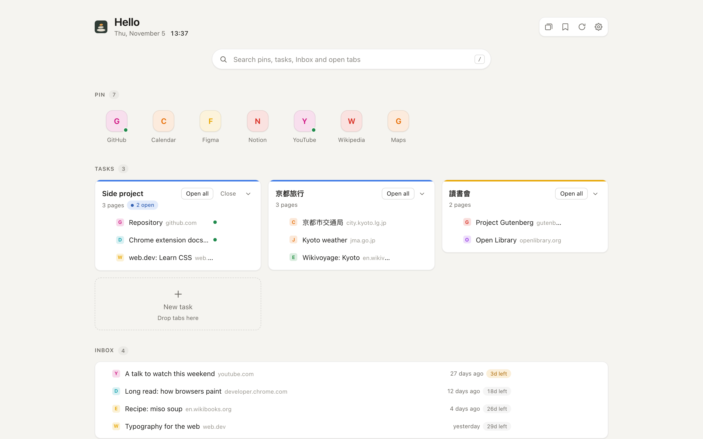
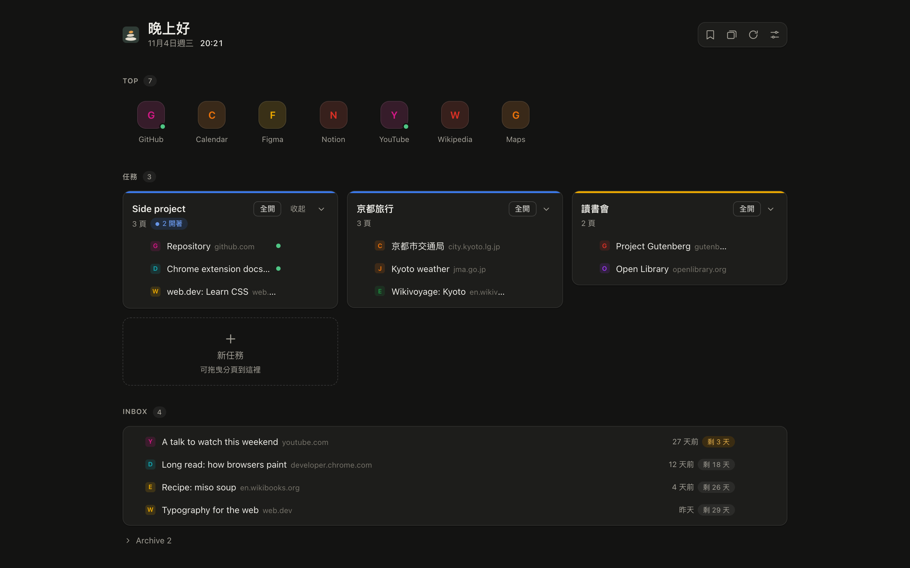
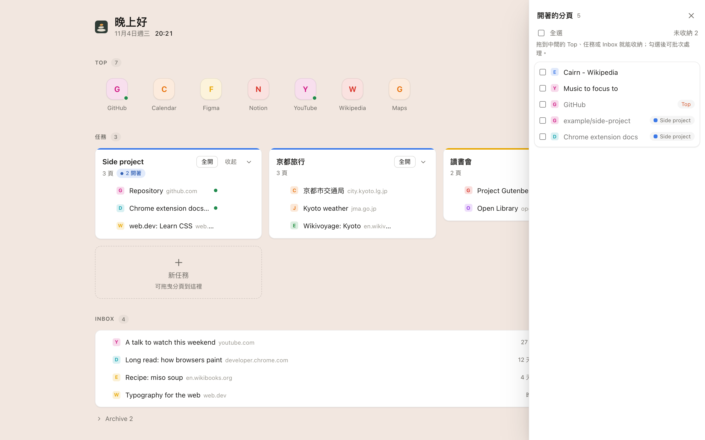
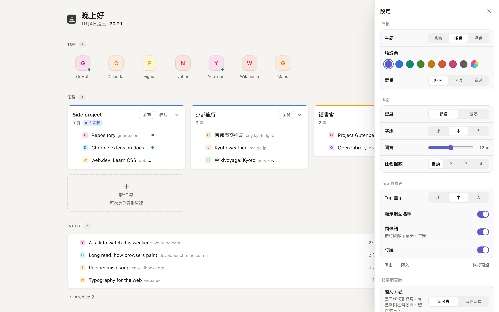

# CairnTab

[English](README.md) | **繁體中文**

**任務常駐，分頁來去。**

CairnTab 把 Chrome 的新分頁換成一個小型任務板，內容全部來自一個書籤資料夾：一鍵直達的常用網站、
每次只開一頁並自動收進專屬分頁群組的任務，以及收放「之後再看」頁面的 Inbox。這些頁面以書籤的形式
保存，而不是一直開著的分頁，所以不再佔用記憶體。

> *Cairn*（石堆）是登山路上堆起來的一疊石頭，標記著你打算回來的地方。
> CairnTab 用同樣的方式標記你的任務，分頁本身就可以放心關掉。

作者：[TuTu](https://github.com/tutul)。目前版本 v0.1，需以「載入未封裝項目」安裝，介面為繁體中文。
採用 Apache-2.0 授權，詳見[授權](#授權)。



<table>
<tr>
<td></td>
<td></td>
<td></td>
</tr>
<tr>
<td align="center">深色主題、青綠強調色</td>
<td align="center">開著的分頁，標示所在位置</td>
<td align="center">設定</td>
</tr>
</table>

<sub>截圖使用虛構的示範資料（`dev/demo.js`）。</sub>

---

## 為什麼

大部分長時間開著的分頁其實不是「正在讀」的頁面，而是提醒。在 Chrome 裡，每一個這樣的分頁都是一個
正在執行的網頁。儲存的分頁群組有幫助，但只能一次全部打開。Arc 用「不載入也能顯示」的釘選資料夾解決
了這個問題；CairnTab 只靠書籤，就把這個模式帶到 Chrome。

## 功能

| 區塊 | 看到什麼 | 點擊後 |
|---|---|---|
| **Top** | 一排最多約 12 個常用網站 | 已開著就切過去，沒開就開進名為 **Top Pin** 的分頁群組。**收起** 關掉這個群組的分頁；圖示上的 **×** 把它移到 `Archive`。不會因為被釘選就一直載入。 |
| **任務** | `Groups` 底下每個資料夾一張卡片，顯示頁面、開著幾頁、上次使用時間 | 只開那一頁，並放進以任務命名的分頁群組。**全開** 開啟其餘頁面；**收起** 關掉這個任務的分頁。 |
| **Inbox** | 暫存的頁面，顯示放了多久、還剩幾天封存。預設最快被封存的在最上面，可在設定改成最新在前，或手動拖曳排序 | 開啟頁面。**Archive** 把它移到 `Archive`。點下方的 **▸ Archive** 可查看已封存的頁面，並 **移回 Inbox**（重新倒數）。 |
| **開著的分頁**（右側抽屜） | 所有開著的分頁。未收納的排前面；已收納的變淡，並標示所在位置（Top、某個任務、Inbox） | 滑過未收納的分頁：**加入任務…** 或 **Move to Inbox**（存成書籤並關掉分頁）。勾選多個（或勾標題列的全選）可批次處理：Move to Inbox、加到 Top、加入任務、關閉分頁。也可以直接拖到 Top、任務或 Inbox。 |

直接改名：點任務標題（開著的分頁群組會一起改名、換色），或用頁面列前方／圖示上出現的 **✎**。
按 Enter 或點別處儲存，Esc 取消；改的是書籤本身的名稱。任務卡片可用 **▾** 收合（會記住）。把頁面
拖到另一頁上（或圖示拖到另一個圖示上）可以排在它前面或後面，也就是重新排序書籤本身。

### 外觀

設定（S）→「外觀」，改了立刻生效、不用重新整理（所有設定，包括資料夾名稱和封存天數，改完就自動儲存）：

- 主題：跟系統／淺色／深色
- 強調色：預設色，或任選顏色
- 背景：純色、強調色調，或自己的圖片（可調遮罩與模糊，卡片會變成霧面）
- 密度、圓角、字級、Top 圖示大小與是否顯示名稱、任務欄數、問候語與時鐘
- 「匯出／匯入」以 JSON 複製設定（不含背景圖片）

Top 圖示的底色取自網站圖示本身；任務卡片的顏色和它的分頁群組一致。

**書籤** 會在左側打開一個抽屜，列出所有書籤。可以把書籤拖到 Top、任務、任務裡的某一頁（放在那裡），
或 Inbox；把整個資料夾拖到 **＋ 新任務** 就變成任務。抽屜裡的 **管理員** 按鈕會在 `Pin` 資料夾打開
Chrome 書籤管理員，用來改名或刪除。

### 什麼情況算「已開著」？

只看分頁目前的網址；分頁一旦瀏覽到別處，就會在「開著的分頁」裡失去標籤。

| 比對方式 | 範例（書籤 → 開著的分頁） |
|---|---|
| 完全相同（忽略 `http(s)`、`www.`、結尾 `/`、`#…`） | `shop.example/products/blue-mug` → `https://www.shop.example/products/blue-mug/` |
| 同一頁，忽略語言路徑，以及書籤本身沒有的查詢參數 | `shop.example/products/blue-mug` → `shop.example/zh-hant/products/blue-mug?tab=1`；但 `google.com/search?q=a` ≠ `?q=b` |
| 在書籤路徑底下 | `notion.so/team` → `notion.so/team/page-123` |
| 書籤是網站首頁，分頁在同網站任何地方 | `shop.example/` → `shop.example/zh-hant/account` |

前兩種會在「開著的分頁」裡標示為已收納；後兩種只會亮起「已開啟」的綠點，並決定點擊時切到哪個分頁。

關掉分頁或整個分頁群組，永遠不會改到你的書籤。任務就是書籤，分頁只是它們的檢視畫面。

## 結構

所有內容都放在書籤列上的一個普通書籤資料夾：

```
書籤列
└─ Pin
   ├─ Top          常用網站（圖示列）
   ├─ Groups
   │  └─ <任務>    每個任務一個資料夾；子資料夾會攤平顯示
   ├─ Inbox        暫存的頁面
   └─ Archive      完成或到期的 Inbox 項目
```

- 隨時可以在 Chrome 書籤管理員裡重新排列、改名、新增或刪除，頁面會即時更新。
- 資料夾名稱不分大小寫；`Pin` 裡其他不認得的項目會原封不動。
- 因為全部都是書籤，會透過 Chrome 同步到你的其他電腦；移除擴充功能也不會遺失任何東西。
- 根資料夾名稱（`Pin`）可以在設定中更改。

## 安裝

尚未上架 Chrome 線上應用程式商店。

1. 下載或 clone 這個 repository。
2. 打開 `chrome://extensions`，開啟右上角的 **開發人員模式**。
3. 點 **載入未封裝項目**，選擇 `extension/` 資料夾。
4. 開一個新分頁。Chrome 詢問是否保留變更後的新分頁時，選 **保留**。
5. 如果還沒有 `Pin` 資料夾，點 **建立 Pin 結構**。如果 `Pin` 已存在但缺少 `Top`／`Groups`／`Inbox`／
   `Archive` 其中幾個，點 **建立缺少的資料夾**；`Pin` 裡原有的項目不會被移動。

需要 Chrome 116 以上版本。

## 使用方式

- **點擊** 項目：已開著就切過去，否則在目前分頁打開。若在設定 →「點擊網頁時」選 **留在這頁**，點擊
  改為在背景開啟、CairnTab 留在前面，方便連續開好幾頁（每次都會有提示；**全開** 也一樣）。
- **⌘／Ctrl 點擊** 永遠是另一種行為；**中鍵點擊** 一律在背景開啟。
- 點擊切到網頁時，預設 CairnTab 這個分頁會直接變成該網頁（若網頁本來就開著，則會關掉 CairnTab）。
  關掉 **切過去時關掉 CairnTab**，網頁就會開在新分頁，CairnTab 留在原處。
- **拖放**：把開著的分頁拖到 **Top**（釘選，分頁保持開著）、**任務**（存進任務並把分頁移進任務群組）、
  **Inbox**（存成書籤並關掉分頁），或 **＋ 新任務**（命名新任務並收進去）。頁面上已有的書籤也能用同樣
  方式在 Top、任務、Inbox 之間拖動。
- **版面**：左邊是書籤抽屜，中間是你的 Pin 資料夾，右邊是開著的分頁（預設收起，可從頁首打開）；設定
  打開時會暫時佔用右側抽屜。抽屜會滑出覆蓋在頁面上，中間欄位不會移動；寬螢幕上抽屜剛好落在兩側空白處，
  窄視窗一次只開一個。抽屜會記住上次是否打開。
- **快捷鍵**：**B** 書籤、**T** 開著的分頁、**R** 重新整理、**S** 設定、**Esc** 關閉抽屜。單一字母，
  在輸入框中打字或按住 ⌘／Ctrl／Alt 時不會觸發。開新分頁後請先點一下頁面：Chrome 會把鍵盤焦點留在網址列。
- **書籤抽屜**：會記住開關狀態和展開的資料夾。Chrome「只在新分頁顯示書籤列」的設定可能不適用於
  CairnTab，抽屜就是用來取代它的。
- **↻**：重新讀取全部內容（例如 Chrome 同步在另一台電腦改了書籤之後）。
- **設定抽屜**：外觀、點擊網頁時的行為、根資料夾名稱、Inbox 項目幾天後移到 `Archive`
  （預設 30 天；`0` 表示不自動封存），以及 Inbox 排序：**快到期**（最快被封存的在前）、**最新**
  （剛存進來的在前）或 **手動**（照書籤順序，可拖曳排序）。排序不影響封存時間。
- 書籤小程式（`javascript:` 連結）會顯示，但擴充功能無法開啟它們。

## 隱私與權限

CairnTab 不發出任何網路請求，沒有伺服器、分析工具或帳號。它只在 `chrome.storage.local` 存一小份
本機紀錄（設定、外觀、上次開啟時間、哪個分頁群組屬於哪個任務），另外可選擇在頁面的 IndexedDB 存一張
背景圖片。這些都不會離開你的瀏覽器。

| 權限 | 用途 |
|---|---|
| `bookmarks` | 讀取 `Pin` 資料夾、把分頁存進 Inbox、把項目移到 Archive |
| `tabs` | 判斷哪些網站已經開著、切換過去、關掉存進 Inbox 的分頁 |
| `tabGroups` | 把任務的頁面放進以任務命名的分頁群組 |
| `storage` | 上述的本機紀錄 |
| `alarms` | 即使當天沒開新分頁，也能把到期的 Inbox 項目封存 |
| `favicon` | 從 Chrome 自己的快取顯示網站圖示 |

## 安全保證

- **永遠不刪除書籤。** Archive 按鈕和到期封存都只是移到 `Archive`；要不要刪除由你決定。
- **分頁永遠不會寫入書籤。** 關掉分頁或群組不可能讓任務消失。
- **即時編輯也安全。** 每個動作都會重新讀取即將處理的書籤。如果你剛好移動或刪除了它，頁面會告訴你並
  重新整理，而不會寫到錯的地方。

## 未來規劃

- 每個任務「每 N 天提醒回顧」
- 英文介面與多語系
- 上架 Chrome 線上應用程式商店

## 開發

沒有建置步驟，也沒有執行期依賴：以「載入未封裝項目」直接載入原生 ES modules。測試需要 Node 20 以上。

```
make ci           # 語法、manifest、純度檢查，然後跑全部測試
make test         # 只跑測試
make preview      # 接著打開 http://127.0.0.1:8770/dev/preview.html
make package      # 把 extension/ 打包成 dist/ 裡的 zip
make icons        # 從 assets/*.svg 重新產生圖示（需要 rsvg-convert）
make screenshots  # 用示範資料重新產生 docs/screenshots（需要先執行 make preview 並安裝 Chrome）
```

`make preview` 會用記憶體中模擬的 Chrome API 執行真正的頁面，不用安裝擴充功能就能在任何瀏覽器檢查介面。
網址加上 `?demo` 使用公開的示範資料，再加 `&theme=dark`、`&accent=teal`、`&bg=tint` 或
`&panel=settings|tabs|bookmarks` 可預設外觀。

```
extension/
  manifest.json, newtab.html/css/js   頁面本身（只處理 DOM）
  background.js                       每日封存檢查
  chrome/                             唯一呼叫 chrome.* 的程式碼
  lib/                                純邏輯，完整單元測試
test/                                 node:test 測試與模擬的 Chrome
docs/                                 概要、規範、架構、決策紀錄（英文）
```

不能違反的規則請先看 [`AGENTS.md`](AGENTS.md)，再看 `docs/`。想參與開發請見
[`CONTRIBUTING.md`](CONTRIBUTING.md)，版本變更見 [`CHANGELOG.md`](CHANGELOG.md)。

## 授權

Copyright 2026 [TuTu](https://github.com/tutul)。採用 [Apache License 2.0](LICENSE) 授權。

你可以使用、修改、再散布 CairnTab，包括商業用途。若你散布它或以它為基礎的作品，請一併附上
[`NOTICE`](NOTICE) 檔，把其中的作者標示放在使用者看得到的地方（說明文件或「關於」畫面），並註明
你修改過的檔案——這是授權條款唯一的要求。
