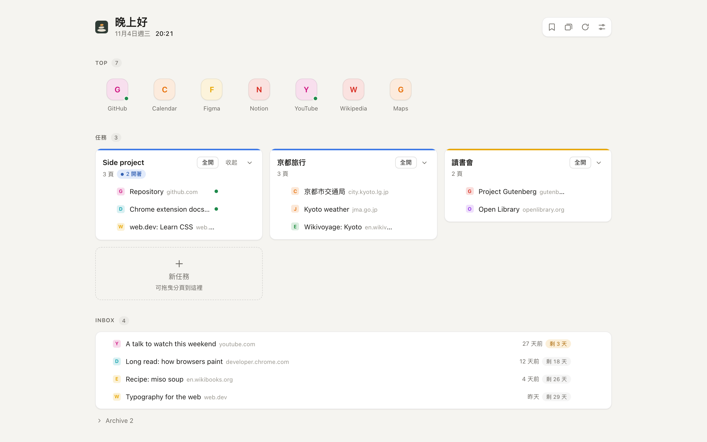
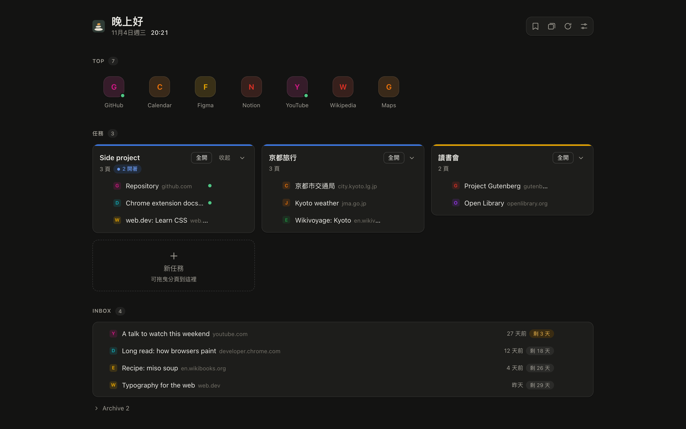
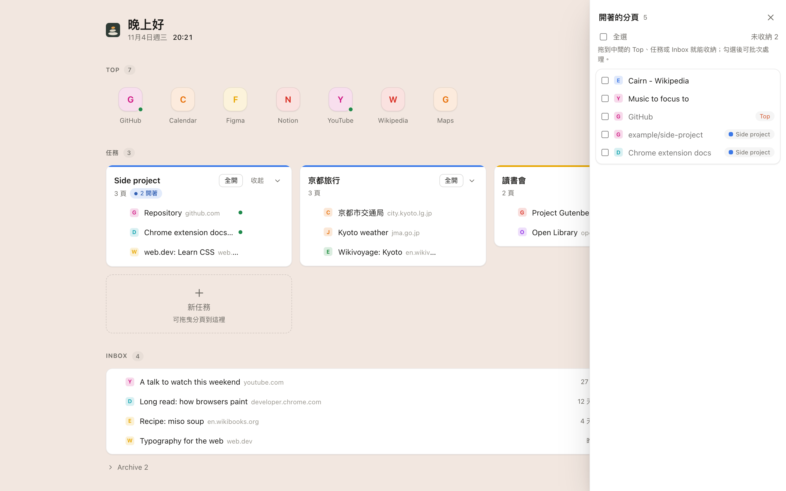
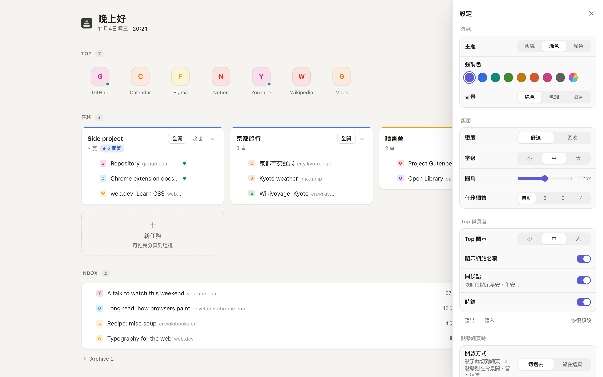

# CairnTab

**Tasks stay, tabs come and go.**

CairnTab replaces Chrome's new tab page with a small task board built from one bookmarks folder.
Pins you reach in one click, tasks that open one page at a time into their own tab group, and an
inbox for "come back to this" pages — kept as bookmarks instead of live tabs, so they stop eating
memory.

> A *cairn* is a stack of stones that marks a trail: a place you mean to come back to.
> CairnTab marks your tasks the same way, so the tabs themselves can be closed without worry.

Created by [TuTu](https://github.com/tutul). Status: v0.1, load-unpacked only. The UI is currently
in Traditional Chinese. Licensed under Apache-2.0 — see [License](#license).



<table>
<tr>
<td></td>
<td></td>
<td></td>
</tr>
<tr>
<td align="center">Dark theme, teal accent</td>
<td align="center">Open tabs, tagged by where they live</td>
<td align="center">Settings</td>
</tr>
</table>

<sub>Screenshots use made-up demo data (`dev/demo.js`).</sub>

---

## Why

Most long-lived tabs are not pages you are reading — they are reminders. In Chrome every one of
them is a running page. Saved tab groups help, but they only open all at once. Arc solved this with
pinned folders that show without loading; CairnTab brings that model to Chrome using nothing but
bookmarks.

## What it does

| Section | What you see | Click |
|---|---|---|
| **Top** | A row of up to ~12 pinned sites | Switches to the tab if it is open, otherwise opens it into a tab group called **Top Pin**. **收起** closes that group's tabs; the **×** on a pin moves it to `Archive`. Pins never stay loaded just because they are pinned. |
| **Tasks** | One card per folder under `Groups`, with its pages, how many are open, and when you last touched it | Opens that single page into a native tab group named after the task. **全開** opens the rest; **收起** closes the task's tabs. |
| **Inbox** | Parked pages, with age and days left before archiving | Opens the page. **Archive** moves it to `Archive`. Click **▸ Archive** under it to see archived pages and **移回 Inbox** (the countdown restarts). |
| **Open tabs** (right panel) | Every open tab. Unfiled ones first; filed ones dimmed with a tag saying where they live (Top, a task, Inbox) | On hover (unfiled tabs): **加入任務…** or **Move to Inbox** (bookmark it, close the tab). Tick several (or the header box for all) to act on them at once: Move to Inbox, 加到 Top, 加入任務, 關閉分頁. Or drag onto Top, a task, or Inbox. |

Rename in place: click a task's title (its open tab group is renamed and recoloured with it), or use
the **✎** that appears at the front of a page row / on a pin. Enter or clicking away saves, Esc
cancels. It renames the bookmark itself. Task cards fold with **▾** (remembered). Drag a page onto another page (or a pin onto another pin)
to put it before/after it — that reorders the bookmarks themselves.

### Appearance

Settings (S) → 外觀 changes the look instantly, no reload (every setting, including the folder name
and archive days, saves as soon as you change it): theme (system / light / dark), accent
colour (presets or any colour), background (plain, a tint of the accent, or your own image with
adjustable dim and blur — cards turn frosted over it), density, corner radius, font size, Top icon
size and labels, number of task columns, and whether to show the greeting and clock. 匯出 / 匯入 copy
the settings as JSON (the image is not included). Top icons sit on a tile tinted from their own
favicon; task cards carry their tab group's colour.

**書籤** opens a drawer on the left with every bookmark. Drag a bookmark from it onto Top, a task, a
task's page (to place it there) or Inbox; drag a whole folder onto **＋ 新任務** to make it a task. The
drawer's **管理員** button opens Chrome's bookmark manager at `Pin` for renaming and deleting.

### When does a bookmark count as "open"?

Only the tab's current URL decides; a tab that browses away simply loses its tag in **Open tabs**.

| Match | Example (bookmark → open tab) |
|---|---|
| Exact (scheme, `www.`, trailing `/`, `#…` ignored) | `shop.example/products/blue-mug` → `https://www.shop.example/products/blue-mug/` |
| Same page, ignoring the language segment and any query the bookmark itself does not have | `shop.example/products/blue-mug` → `shop.example/zh-hant/products/blue-mug?tab=1`; but `google.com/search?q=a` ≠ `?q=b` |
| Inside the bookmarked path | `notion.so/team` → `notion.so/team/page-123` |
| Site front page bookmarked, tab anywhere on the site | `shop.example/` → `shop.example/zh-hant/account` |

The first two also tag the tab in **Open tabs** as filed; the last two only light the "open" dot and
decide where a click goes.

Closing tabs or whole tab groups never changes your bookmarks. Your tasks are the bookmarks; tabs
are just views of them.

## How it is organised

Everything lives in a normal bookmarks folder on the bookmarks bar:

```
Bookmarks bar
└─ Pin
   ├─ Top          pinned sites (icon row)
   ├─ Groups
   │  └─ <task>    one folder per task; subfolders are flattened
   ├─ Inbox        parked pages
   └─ Archive      finished or expired Inbox items
```

- Rearrange, rename, add or delete anything in Chrome's bookmark manager at any time; the page
  updates live.
- Folder names are case-insensitive. Anything else inside `Pin` is left alone.
- Because it is all bookmarks, it syncs across your computers with Chrome Sync, and nothing is lost
  if you uninstall the extension.
- The root folder name (`Pin`) can be changed in settings.

## Install

Not on the Chrome Web Store yet.

1. Download or clone this repository.
2. Open `chrome://extensions` and turn on **Developer mode**.
3. Click **Load unpacked** and choose the `extension/` folder.
4. Open a new tab. When Chrome asks whether to keep the changed new tab page, choose **Keep it**.
5. If there is no `Pin` folder yet, click **建立 Pin 結構** (create structure). If `Pin` exists but
   lacks some of `Top`/`Groups`/`Inbox`/`Archive`, click **建立缺少的資料夾**; existing items in `Pin`
   are left where they are.

Requires Chrome 116 or later.

## Using it

- **Click** an item: focus it if open, otherwise open it in the current tab. With settings →
  點擊網頁時 → **留在這頁**, a click instead opens it in the background and CairnTab stays in front,
  so you can open several in a row (a toast confirms each; 全開 does the same).
- **⌘/Ctrl-click** does whichever of the two the plain click does not; **middle-click** always opens
  in the background.
- When a click goes to the page, CairnTab normally turns into it (or closes, if the page was already
  open). Turn off **切過去時關掉 CairnTab** to open the page in a new tab and keep CairnTab where it is.
- **Drag and drop**: drag an open tab onto **Top** (pin it, tab stays open), a **task** (bookmark it
  there and move the tab into the task's group), **Inbox** (bookmark it and close the tab), or
  **＋ 新任務** (name a new task and file the tab into it). Bookmarks already on the page can be
  dragged between Top, tasks and Inbox the same way.
- **Layout**: bookmarks drawer on the left, your Pin folder in the middle, open tabs on the right
  (closed by default; open it from the header). **Esc** closes any open drawer.
- **Keys**: **B** bookmarks, **T** open tabs, **R** refresh, **S** settings, **Esc** close drawers. Plain
  letters, ignored while typing in a field or with ⌘/Ctrl/Alt held. Click the page once first:
  Chrome keeps keyboard focus in the address bar on a new tab. Settings take over the right panel while open and hand it back
  when closed. Both panels are drawers that slide over the page, so the middle column never moves;
  on wide windows they sit in the empty margins. Header icons (hover for a label): bookmarks, open
  tabs, ↻ refresh, settings. Panels remember whether they were open; on narrow windows only one opens
  at a time.
- **Bookmarks drawer**: open/closed and expanded folders are remembered. Chrome's
  "bookmarks bar only on the new tab page" may not apply to CairnTab; the drawer replaces it.
- **↻**: re-read everything (useful after Chrome Sync changes bookmarks on another device).
- **Settings drawer**: root folder name, and after how many days Inbox items move to `Archive`
  (default 30; `0` turns archiving off).
- Bookmarklets (`javascript:` links) are shown but cannot be opened from an extension.

## Privacy and permissions

CairnTab makes no network requests and has no server, analytics or account. Its only stored data
is a small local record (settings, appearance, last-opened times, which tab group belongs to which
task) in `chrome.storage.local`, plus an optional background image in the page's IndexedDB. None of
it leaves your browser.

| Permission | Used for |
|---|---|
| `bookmarks` | Reading the `Pin` folder, parking tabs into Inbox, moving items to Archive |
| `tabs` | Knowing which pins are already open, switching to them, closing parked tabs |
| `tabGroups` | Putting a task's pages into a tab group named after the task |
| `storage` | The small local record above |
| `alarms` | Archiving expired Inbox items even on days you open no new tab |
| `favicon` | Showing site icons from Chrome's own cache |

## Safety guarantees

- **Never deletes a bookmark.** The Archive button and expiry move items to `Archive`; deleting is up to you.
- **Tabs never write to bookmarks.** Closing tabs or groups cannot lose a task.
- **Safe with live edits.** Every action re-reads the bookmark it is about to touch. If you moved
  or deleted it meanwhile, the page says so and refreshes instead of writing to the wrong place.

## Roadmap

- Per-task "review every N days" reminders
- English UI and i18n
- A Chrome Web Store listing

## Development

No build step and no runtime dependencies: plain ES modules loaded unpacked. Tests need Node ≥ 20.

```
make ci        # syntax, manifest and purity checks, then all tests
make test      # tests only
make preview   # then open http://127.0.0.1:8770/dev/preview.html
make package   # zip extension/ into dist/
make icons     # re-render icons from assets/*.svg (needs rsvg-convert)
make screenshots  # re-render docs/screenshots from the demo data (needs make preview + Chrome)
```

`make preview` renders the real page against an in-memory fake of the Chrome APIs, so the UI can
be checked in any browser without installing the extension. Add `?demo` for the public demo data,
and `&theme=dark`, `&accent=teal`, `&bg=tint` or `&panel=settings|tabs|bookmarks` to preset the look.

```
extension/
  manifest.json, newtab.html/css/js   the page (DOM only)
  background.js                       daily archive sweep
  chrome/                             the only code that calls chrome.*
  lib/                                pure logic, fully unit-tested
test/                                 node:test suites + the Chrome fake
docs/                                 brief, conventions, architecture, decision log
```

Start with [`AGENTS.md`](AGENTS.md) for the rules that must not break, then `docs/`.
Contributions: see [`CONTRIBUTING.md`](CONTRIBUTING.md). Changes: [`CHANGELOG.md`](CHANGELOG.md).

## License

Copyright 2026 [TuTu](https://github.com/tutul). Licensed under the [Apache License 2.0](LICENSE).

You may use, modify and redistribute CairnTab, including commercially. If you ship it or anything
built from it, keep the [`NOTICE`](NOTICE) file with it and show its attribution where your users
can read it (documentation or an about screen), and mark the files you changed — that is what the
license asks in return.

---

## 中文說明

**任務常駐，分頁來去。**

CairnTab 把 Chrome 的新分頁換成一個小型任務板，資料全部來自書籤列上的 `Pin` 資料夾：

- **Top**：約 12 個常用網站。已開就切過去，沒開才打開，並放進名為「Top Pin」的分頁群組；「收起」可一次關掉這些分頁。不會因為被釘選而一直佔記憶體。
- **任務**：`Groups` 底下每個資料夾是一個任務。可以只開其中一頁，它會自動進到以任務命名的分頁群組；「全開」開啟其餘頁面，「收起」關掉這個任務的分頁，書籤不受影響。
- **Inbox**：想之後再看的頁面。按「Move to Inbox」（或把分頁拖進 Inbox）會把分頁存成書籤並關掉，釋放記憶體；放超過設定天數（預設 30 天，0 為不封存）會自動移到 `Archive`。
- **Archive**：一律移到 `Archive`，擴充永遠不會刪除你的書籤。

點網頁後要不要離開 CairnTab，可以在設定 →「點擊網頁時」選：「切過去」（預設，這個分頁變成該網頁）或「留在這頁」（在背景開新分頁，方便連開好幾個）。⌘ 點擊永遠是另一種。切過去時預設會把 CairnTab 這個分頁變成網頁；關掉「切過去時關掉 CairnTab」則會開新分頁、CairnTab 留在原處。分頁標題顯示為「CairnTab」。

外觀可以在設定（S）→「外觀」調整，改了立刻生效：主題、強調色、背景（純色／強調色調／自己的圖片，可調遮罩與模糊）、密度、圓角、字級、Top 圖示大小與名稱、任務欄數、問候語與時鐘，也能匯出／匯入。

下方「開著的其他分頁」可以直接拖到 Top、任務卡片、Inbox，或「＋ 新任務」。

所有內容都是一般書籤，可以隨時在書籤管理員裡新增、移動、刪除，畫面會即時更新；也會跟著 Chrome 同步到其他電腦。

作者：[TuTu](https://github.com/tutul)。授權：Apache-2.0；散布或改作時須保留 `NOTICE` 檔中的作者標示，並註明修改過的檔案。

安裝方式：打開 `chrome://extensions` → 開啟「開發人員模式」→「載入未封裝項目」→ 選 `extension/` 資料夾。
